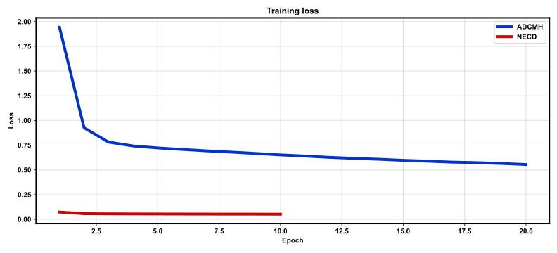
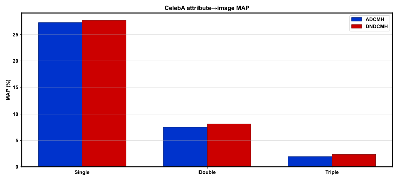

# REPORT: DNDCMH — full

**Protocol:** `full`  
**Package:** `dndcmh`  

## Summary

| Method | Single MAP | Double MAP | Triple MAP |
|--------|------------|------------|------------|
| ADCMH | 27.27% | 7.51% | 1.92% |
| DNDCMH | 27.71% | 8.13% | 2.35% |

## Training

- ADCMH epochs: 20
- NECD epochs: 10
- Train images: 162770
- Hash bits: 63
- Margin m / ECC e: 6.0 / 6
- Elapsed: 2542.73 s
- Checkpoint: `outputs/checkpoints/full/last.pt`

## Figures

### `train_loss.svg`



### `map_by_arity.svg`



## Reproduce

```bash
bash scripts/smoke.sh   # or train_full.sh
bash scripts/eval.sh configs/default.yaml
bash scripts/report.sh
```

## Notes

- Metrics from real CelebA train/eval only.
- YTF not available; LFW attribute protocol deferred (see DEVIATIONS.md).
